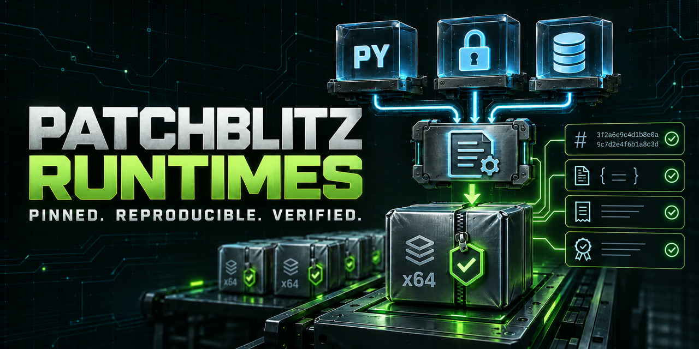

# PatchBlitz runtimes

  

Pinned, reproducible runtime archives bundled by the PatchBlitz Enterprise
Windows setup. This repository holds only the build recipes and their
published release artifacts; it contains no PatchBlitz product source.

> **Repository status: supply-chain support only.** This is not a standalone PatchBlitz application, installer, SDK, or general-purpose Python distribution. End users should not add the archive to `PATH` or substitute it for a system Python installation. The PatchBlitz installer consumes an exact tag, filename, size, and digest from its private runtime lock.

The parent product remains private. This public repository exists so customers and reviewers can inspect how the bundled runtime is assembled, which upstream components and licenses it contains, and whether a downloaded archive matches its published evidence.

## Python runtime

Release tag: `patchblitz-python-3.14.9-openssl-3.5.9`

| Component | Version | Source |
|---|---|---|
| CPython | 3.14.9 | [python-build-standalone](https://github.com/astral-sh/python-build-standalone) release `20261021`, `install_only_stripped` x86_64 Windows build |
| OpenSSL | 3.5.9 (29 Sep 2026) | As built upstream by python-build-standalone |
| SQLite | 3.54.1 | Official amalgamation from sqlite.org, compiled with the same feature set as the upstream DLL |
| pip | 26.2.2 | As bundled upstream |

[`scripts/Build-PatchBlitz-PythonRuntime.ps1`](scripts/Build-PatchBlitz-PythonRuntime.ps1)
builds the archive. It:

1. Downloads the upstream CPython archive and verifies its size and SHA-256.
2. Copies the upstream third-party license texts from the same release's full build into `python/licenses/`.
3. Compiles `DLLs/sqlite3.dll` from the SQLite amalgamation (verified by the SHA3-256 sqlite.org publishes) and checks that it reports every upstream compile option.
4. Removes the Tcl/Tk GUI stack (`tkinter`, IDLE, turtle), which a headless server never loads.
5. Verifies the Python, OpenSSL, SQLite, and pip identities, and runs a smoke test.
6. Writes a deterministic `tar.gz` and a JSON record of every input digest and the resulting tree identity.

With the pinned inputs and exact toolchain identities recorded by the recipe,
repeated builds on a matching Windows environment are intended to produce the
same archive bytes. Always compare the resulting digest; cross-machine byte
identity is not claimed when receipt toolchain identities differ. Requirements:
PowerShell 7.4+, Visual Studio 2022 17.14.37824.6 with MSVC 14.44.35207, and
Windows SDK 10.0.26100.0.

## Verify the published runtime

The current [runtime release](https://github.com/fusiontechstrategies/Patchblitz-runtimes/releases/tag/patchblitz-python-3.14.9-openssl-3.5.9) contains three assets:

- the deterministic Windows x64 runtime archive;
- a JSON build record containing the build-recipe digest, complete input and
  tree identities, and exact Visual Studio, MSVC, Windows SDK, compiler, linker,
  resource compiler, PowerShell, and operating-system identities; and
- `SHA256SUMS` for independent comparison.

Treat the exact release tag and asset digest as one identity. Do not consume a moving "latest" URL, a GitHub-generated source archive, or a similarly named file from another location. The public assets are inputs to the separately guarded PatchBlitz installer; downloading an archive directly does not reproduce the installer's verification, destination protections, or product compatibility checks.

## Update policy

A runtime refresh requires a new versioned tag and a rebuilt evidence set. Before the private product lock can change, the archive must be rebuilt twice, match byte for byte, pass its identity and smoke checks, retain all required license texts, and be reviewed against the product's supported Windows and installer boundary. Older releases remain evidence for the product versions that pinned them.

Report suspected build-script, archive-integrity, provenance, or secret-exposure problems through [SECURITY.md](SECURITY.md). General PatchBlitz product support and product-source requests are outside this repository.

## Licenses

Each archive keeps the licenses of what it contains:

- CPython: Python Software Foundation License (`python/LICENSE.txt`).
- OpenSSL: Apache-2.0.
- SQLite: public domain.
- libffi, mpdecimal, liblzma, zlib, bzip2, zstd, Expat and others: under their own licenses.

The full upstream texts are in `python/licenses/`.

The build recipe is Copyright (c) 2026 Fusion Technology Strategies, Inc.

Explore the maintained applications and specialist utilities in the [Fusion Technology Strategies public portfolio](https://github.com/fusiontechstrategies/FusionTechStrategies).
